## &#128204; Quick Links
[Overview](#-overview) | [Important Dates](#-important-dates) | [Call for Papers](#-call-for-papers) | [Keynote Speakers](#-keynote-speakers) | [Tentative Schedule](#-tentative-schedule) | [Organizers](#-organizers)

---

## &#128214; Overview

The deployment of autonomous robots in real-world applications is increasing rapidly.
On one hand, the long-term performance of these systems depends heavily on their ability to perceive and interpret complex, dynamically changing environments, as well as their capacity to learn and adapt to new situations over extended periods.
On the other hand, how to construct effective benchmarks for real-world deployment that can be widely adopted remains a very open question.
These considerations gave rise to LoWi.
Since its 1st edition, LoWi has followed a philosophy: while maintaining an overarching theme and research context for each edition (represented by the main title), it can focus on specific aspects (represented by the subtitle).
The 2nd edition of LoWi will be held in conjunction with the **Spatio-Temporal Intelligence (STI)** workshop.
Through a **debate-style** format, we aim to gather insights on the consensus and points of contention within the community regarding topics of mutual interest, ultimately providing guidance for future research directions and technological development paths.
Accordingly, the subtitle for the 2nd edition of LoWi is: **Consensus, Controversies, and Perspectives**.
Specifically, we have identified three themes: **Real-world Deployment**, **4D Perception and Intelligence**, and **Long-term Autonomy**.
Each theme encompasses a specific question, two distinct viewpoints (labeled as *pro* and *con*), and a proposed action to be pursued following the workshop.

---

## &#128197; Important Dates

* **Paper Submission Deadline:** March 31, 2027 (23:59 Anywhere on Earth)
* **Notification of Acceptance:** April 24, 2027
* **Workshop Date:** May 24 or 28, 2027

---

## &#128227; Call for Papers

Coming soon!

### Submission Guidelines
* **Paper Format:** Position papers (1-2 pages) Extended Abstracts (2-4 pages) or Full Papers (6-8 pages), using the [IEEE ICRA template](https://ras.papercept.net/conferences/support/support.php).
* **Submission Portal:** [https://cmt3.research.microsoft.com/LoWi2027](https://cmt3.research.microsoft.com/LoWi2027)
* **Publication Policy:** Non-archival. Papers presented here can be submitted to other conferences/journals later.

---

## &#127908; Keynote Speakers

  

    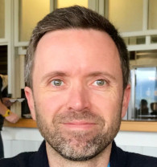
     
    <strong><a href="http://asrl.utias.utoronto.ca/~tdb" target="_blank">Prof. Tim Barfoot</a></strong>
     
    <small>University of Toronto, Canada</small>
    

    
"Title to be announced"

  

  

    
     
    <strong><a href="http://ais.uni-bonn.de/behnke" target="_blank">Prof. Sven Behnke</a></strong>
     
    <small>University of Bonn, Germany</small>
    

    
"Title to be announced"

  

  

    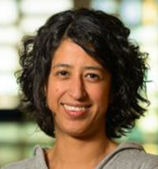
     
    <strong><a href="https://profiles.uts.edu.au/Teresa.VidalCalleja" target="_blank">Prof. Teresa Vidal-Calleja</a></strong>
     
    <small>University of Technology Sydney, Australia</small>
    

    
"Title to be announced"

  

  

    
     
    <strong><a href="https://ppolon.github.io/" target="_blank">Dr. Jonghyun Choi</a></strong>
     
    <small>Seoul National University, South Korea</small>
    

    
"Title to be announced"

  

  

    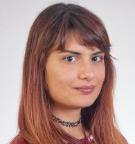
     
    <strong><a href="https://research.tudelft.nl/en/persons/m-popovic" target="_blank">Dr. Marija Popović</a></strong>
     
    <small>TU Delft, Netherlands</small>
    

    
"Title to be announced"

  

  

    
     
    <strong><a href="http://urobot.kaist.ac.kr/" target="_blank">Prof. Hyun Myung</a></strong>
     
    <small>KAIST, South Korea</small>
    

    
"Title to be announced"

  

---

## &#128344; Tentative Schedule

| Time | Session / Event | Speaker / Details |
| :--- | :--- | :--- |
| 08:45 - 09:00 | Welcome & Workshop Overview | Organizers |
| 09:00 - 09:30 | **Keynote 1 (Theme 1, Pro)** | Prof. Tim Barfoot |
| 09:30 - 10:00 | **Keynote 2 (Theme 1, Con)** | Prof. Sven Behnke |
| 10:00 - 10:30 | Oral Presentations (Theme 1, Pro & Con) | Accepted Authors |
| 10:30 - 11:00 | Coffee Break & Poster Session A (setup) | - |
| 11:00 - 11:30 | **Keynote 3 (Theme 2, Pro)** | Prof. Teresa Vidal-Calleja |
| 11:30 - 12:00 | **Keynote 4 (Theme 2, Con)** | Dr. Jonghyun Choi |
| 12:00 - 12:30 | Oral Presentations (Theme 2, Pro & Con) | Accepted Authors |
| 12:30 - 14:00 | Lunch Break & Poster Session A (continued) | - |
| 14:00 - 14:30 | **Keynote 5 (Theme 3, Pro)** | Dr. Marija Popović |
| 14:30 - 15:00 | **Keynote 6 (Theme 3, Con)** | Prof. Hyun Myung |
| 15:00 - 15:30 | Oral Presentations (Theme 3, Pro & Con) | Accepted Authors |
| 15:30 - 16:20 | Coffee Break and Poster Session B | - |
| 16:20 - 16:30 | Two Startup Presentations | TABxStartups |
| 16:30 - 17:30 | Interactive Panel Discussion | All Speakers |
| 17:30 - 17:45 | Best Presentation Awards & Closing | Organizers |

---

## &#128101; Organizers

### LoWi Team

  

    
     
    <strong><a href="https://yzrobot.github.io/" target="_blank">Zhi Yan</a></strong>
     
    <small>ENSTA, Institut Polytechnique de Paris, France</small>
  

  

    
     
    <strong><a href="https://www.ensta-paris.fr/fr/francois-goulette" target="_blank">François Goulette</a></strong>
     
    <small>ENSTA, Institut Polytechnique de Paris, France</small>
  

  

    
     
    <strong><a href="https://filliat.github.io/" target="_blank">David Filliat</a></strong>
     
    <small>AMIAD, France</small>
  

  

    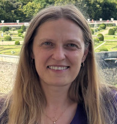
     
    <strong><a href="https://fr.linkedin.com/in/martynaporeba" target="_blank">Martyna Poreba</a></strong>
     
    <small>CEA List, Université Paris-Saclay, France</small>
  

  

    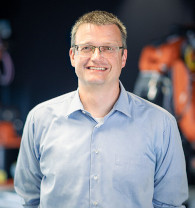
     
    <strong><a href="https://www.informatik.uni-wuerzburg.de/robotics/team/nuechter/" target="_blank">Andreas Nüchter</a></strong>
     
    <small>University of Würzburg, Germany</small>
  

  

    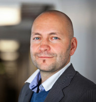
     
    <strong><a href="https://www.ce.cit.tum.de/pins/team/achim-j-lilienthal/" target="_blank">Achim J. Lilienthal</a></strong>
     
    <small>Technical University of Munich, Germany</small>
  

  

    
     
    <strong><a href="https://teacher.nwpu.edu.cn/yangtao2020.html" target="_blank">Tao Yang</a></strong>
     
    <small>Northwestern Polytechnical University, China</small>
  

  

    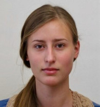
     
    <strong><a href="https://www.linkedin.com/in/katalin-sch%C3%A4ffer-059a1523b/" target="_blank">Katalin Sc̈haffer</a></strong>
     
    <small>Czech Technical University in Prague, Czechia</small>
  

  

    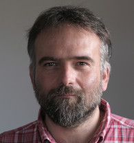
     
    <strong><a href="https://chronorobotics.fel.cvut.cz/" target="_blank">Tomas Krajnik</a></strong>
     
    <small>Czech Technical University in Prague, Czechia</small>
  

### STI Team

  

    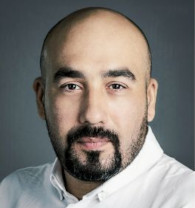
     
    <strong><a href="http://ferasdayoub.com/" target="_blank">Feras Dayoub</a></strong>
     
    <small>Adelaide University, Australia</small>
  

  

    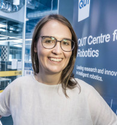
     
    <strong><a href="https://www.qut.edu.au/about/our-people/academic-profiles/d24.miller" target="_blank">Dimity Miller</a></strong>
     
    <small>Queensland University of Technology, Australia</small>
  

  

    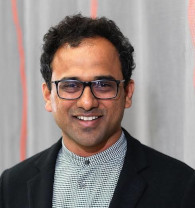
     
    <strong><a href="https://www.perceptica-robotics.com/" target="_blank">Rajat Talak</a></strong>
     
    <small>National University of Singapore, Singapore</small>
  

  

    
     
    <strong><a href="http://roboticimaging.org/" target="_blank">Donald G. Dansereau</a></strong>
     
    <small>University of Sydney, Australia</small>
  

  

    
     
    <strong><a href="http://www.nikosuenderhauf.info/" target="_blank">Niko Sünderhauf</a></strong>
     
    <small>Queensland University of Technology, Australia</small>
  

---

## &#128260; Looking for the previous edition?

[1st Workshop on Long-term Deployments in the Wild (LoWi)](https://mobile-robotics-hub.github.io/workshop2026/)

---

## &#129309; Sponsors

---

## &#128300; Supporters

&nbsp;&nbsp;&nbsp;&nbsp;&nbsp;
<a href="https://www.cea.fr/">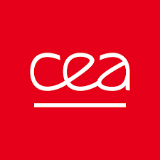</a>&nbsp;&nbsp;&nbsp;&nbsp;&nbsp;
<a href="https://www.hi-paris.fr/">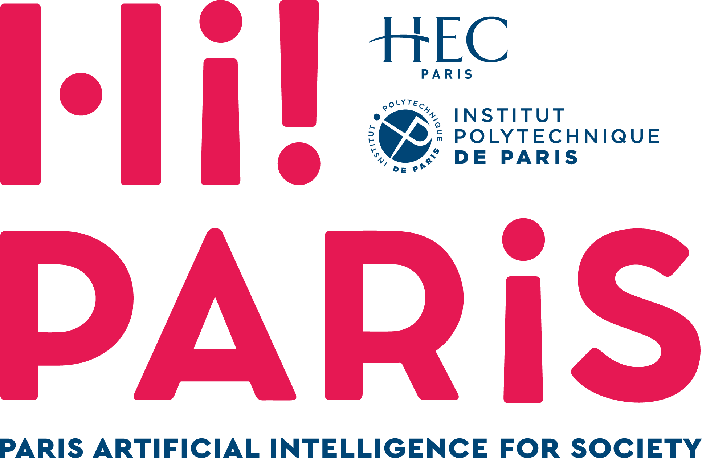</a>&nbsp;&nbsp;&nbsp;&nbsp;&nbsp;
&nbsp;&nbsp;&nbsp;&nbsp;&nbsp;
&nbsp;&nbsp;&nbsp;&nbsp;&nbsp;
&nbsp;&nbsp;&nbsp;&nbsp;&nbsp;
<a href="https://www.cvut.cz/en">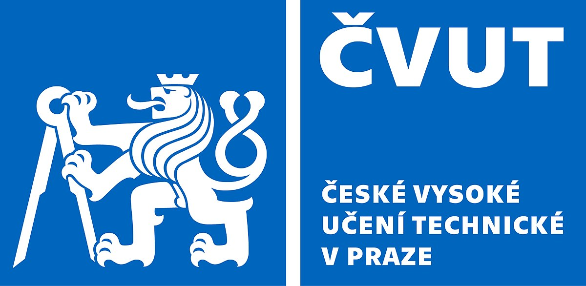</a>&nbsp;&nbsp;&nbsp;&nbsp;&nbsp;
&nbsp;&nbsp;&nbsp;&nbsp;&nbsp;
&nbsp;&nbsp;&nbsp;&nbsp;&nbsp;
&nbsp;&nbsp;&nbsp;&nbsp;&nbsp;
&nbsp;&nbsp;&nbsp;&nbsp;&nbsp;

---

## &#128172; Contact

If you have any questions, please contact us at [lowiworkshop@gmail.com](mailto:lowiworkshop@gmail.com).

---

The Microsoft CMT service was used for managing the peer-reviewing process for this conference. This service was provided for free by Microsoft and they bore all expenses, including costs for Azure cloud services as well as for software development and support.
